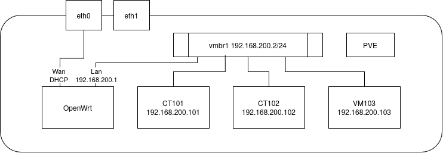

# Proxmox VE 配置记录

本文以PVE9.2为例，记录配置过程。

## 分区

安装时可以选择btrfs+zstd压缩，获得更灵活的空间和子卷配置能力，并且可以避免ext4格式下自动给你主分区200G加上一个lvm-thin的情况。记得选硬盘的时候不要选上安装u盘。

btrfs模式唯一的问题是其Profile为`RAID0`而不是`single`，导致无法启用swapfile。  
检查方法：
```
btrfs filesystem df /
```

转换方法：
```
sudo btrfs balance start -dconvert=single /
```

创建swapfile：
```
sudo btrfs filesystem mkswapfile --size 8G /swapfile
sudo swapon /swapfile
```

添加到`/etc/fstab`：
```
/swapfile none swap defaults 0 0
```

btrfs定时维护：
```
sudo apt install btrfsmaintenance
```

## 换源

[https://help.mirror.nju.edu.cn/proxmox/](https://help.mirror.nju.edu.cn/proxmox/)

## 网络

鉴于PVE本身的网络管理功能较少，我使用OpenWrt容器来接管整个PVE的网络。



此时通过`eth0`连接到的是OpenWrt，PVE在OpenWrt下的LAN网段，需要在owrt上配置端口转发才可以访问。这样OpenWrt可以起到防火墙的作用，同时你可以自由添加其他网络功能。`eth1`这里没有画出功能，你可以将它接入`vmbr1`从而接入owrt的LAN网段，也可以直接交给某个容器接管，也可以留着做pve的备用网口，如果只有单网口也不影响这个架构，十分灵活。

### 配置方法

以上配置需要将PVE断开连接，所以需要当心。如果误配导致断开连接，可以物理操作PVE，使用`pct`命令操作容器之类，比如`pct enter <ctid>`。

#### 安装OpenWrt

点击`数据中心`-`pve`-`系统`-`网络`，创建一个vmbr1，并设置CIDR为`192.168.200.2/24`，网关为`192.168.200.1`。注意，这里vmbr1的ip即PVE在Openwrt LAN下的ip，我们可以通过转发端口到该ip进行访问。

点击`数据中心`-`pve`-`local-btrfs`-`CT模板`-`从URL下载`，这里以[25.12.6](https://downloads.openwrt.org/releases/25.12.6/targets/x86/generic/openwrt-25.12.6-x86-generic-rootfs.tar.gz)为例。下载后创建容器，取消勾选“无特权的容器”（即创建一个特权容器，方便通入设备），然后根据需要进行配置，基本上2核2G很够用了。添加的网口记得桥接到vmbr1上，设置cidr为`192.168.200.1/24`，网关为`192.168.200.1`。

配置完后不要启动，编辑`/etc/pve/lxc/100.conf`，添加以下内容
```
lxc.net.0.type: phys
lxc.net.0.link: nic0
lxc.net.0.name: eth0
lxc.net.0.flags: up
lxc.mount.entry: /dev/ppp dev/ppp none bind,create=file
lxc.mount.entry: /dev/net/tun dev/net/tun none bind,create=file
lxc.cgroup2.devices.allow: a
lxc.cgroup2.cpuset.cpus: 4-7,20-23
```
前几行是直通`nic0`网卡，中间是通入`ppp`和`tun`设备，最后是将容器锁定在特定核心，防止调度问题（比如大小核或跨ccd）。

然后启动owrt，使用`pct enter 100`进入owrt，由于需要从owrt的wan口进行配置，你需要临时关闭owrt的防火墙：`/etc/init.d/firewall stop`，然后进去转发OpenWrt和PVE等的端口，这样就可以通过你熟悉的webui配置owrt了。

其他容器/VM的ip可以直接设置成其ID，方便配置和记忆。此时vmbr0可以删掉了，接入vmbr1即可。

如果你想把`nic1`也接入owrt的lan，可以在`vmbr1`的设置中向`网桥端口`添加`nic1`，这样就连接上了。

## 设备直通

有时需要直通显卡等设备给容器用。

> 需要注意的一点是，这里的“直通”说法并不准确。从原理上说，Linux一切皆文件，这里的操作是PVE允许容器访问特定的设备文件，以实现容器“直通”设备的功能。因此它和VM的直通最大的区别就是，多个容器可以共享使用一个设备，而虚拟机的直通直接从驱动层面接管了设备，只允许一个虚拟机使用，除非使用SR-IOV技术从驱动层面拆分物理设备。

> PVE9.2的设备直通方式已经非常简单，无需再创建特权容器或手动编辑容器的配置文件，既方便又安全。

这里我们以非特权容器和显卡直通为例，首先我们需要了解哪些是显卡的设备文件。

```
ls -la /dev/dri/*
crw-rw---- 1 root video  226,   1 Nov  9 21:10 /dev/dri/card1
crw-rw---- 1 root render 226, 128 Nov  9 21:09 /dev/dri/renderD128

/dev/dri/by-path:
total 0
drwxr-xr-x 2 root root  80 Nov  9 21:09 .
drwxr-xr-x 3 root root 100 Nov  9 21:09 ..
lrwxrwxrwx 1 root root   8 Nov  9 21:09 pci-0000:c7:00.0-card -> ../card1
lrwxrwxrwx 1 root root  13 Nov  9 21:09 pci-0000:c7:00.0-render -> ../renderD128
```

一般来说直通这里的设备即可得到图形加速能力。如果有多显卡，可以通过下面的pcie通道号和`lspci`命令进行判断。

进入你要配置的容器，输入以下命令：
```
root@jellyfin:~# getent group video
video:x:44:jellyfin
root@jellyfin:~# getent group render
render:x:992:jellyfin
```

记住输出的44和992这两个GID。然后点击该容器的`资源`-`新增`-`设备直通`
- `/dev/dri/card1`，`CT中的GID`输入`44`（`video` GID）
- `/dev/dri/renderD128`，`CT中的GID`输入`992`（`render` GID）

再进入容器内`ls -la /dev/dri/*`就可以看到设备了。jellyfin可以正确实现显卡加速（其实它只需要`renderD128`）。

- 如果需要用AMD核显跑ROCm等负载，用同样的方法直通`/dev/kfd`。
- 如果是nvidia,还需要通入以下东西
    ```
    $ ls -la /dev/nvidia*
    crw-rw-rw- 1 root root 195,   0 Feb 25 13:12 /dev/nvidia0
    crw-rw-rw- 1 root root 195, 255 Feb 25 13:12 /dev/nvidiactl
    crw-rw-rw- 1 root root 195, 254 Feb 25 13:12 /dev/nvidia-modeset
    crw-rw-rw- 1 root root 510,   0 Feb 25 13:12 /dev/nvidia-uvm
    crw-rw-rw- 1 root root 510,   1 Feb 25 13:12 /dev/nvidia-uvm-tools
    
    /dev/nvidia-caps:
    total 0
    drwxr-xr-x  2 root root     80 Feb 25 13:12 .
    drwxr-xr-x 19 root root   4400 Feb 25 13:12 ..
    cr--------  1 root root 235, 1 Feb 25 13:12 nvidia-cap1
    cr--r--r--  1 root root 235, 2 Feb 25 13:12 nvidia-cap2
    ```
    然后在容器中安装相同版本的nvidia驱动`./NVIDIA_xxx.run --no-kernel-module`，同理`cuda_xxx.run --override`可以安装cuda。

